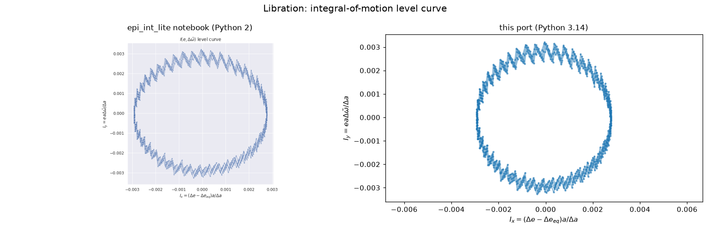
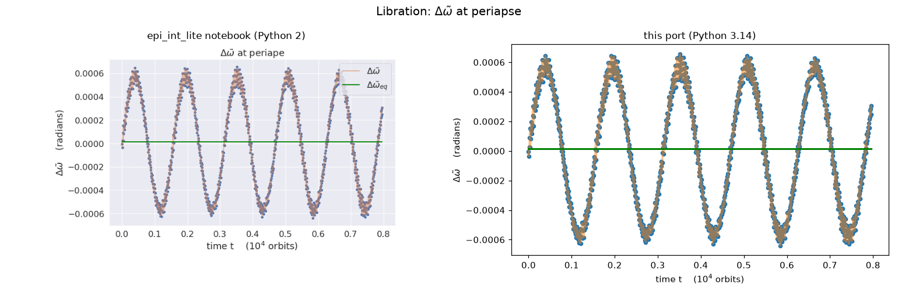
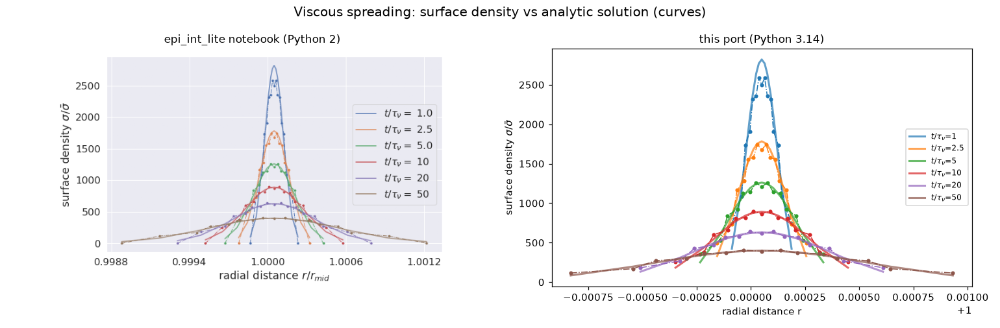
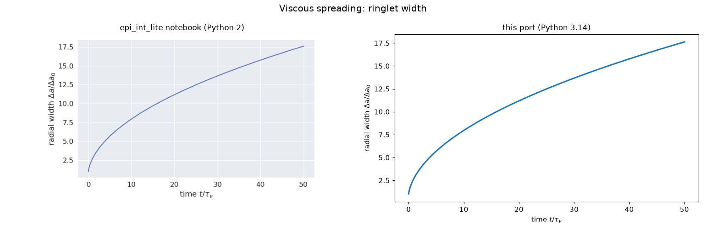
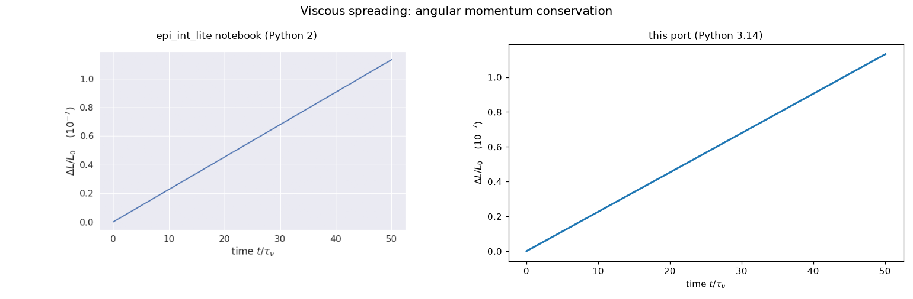
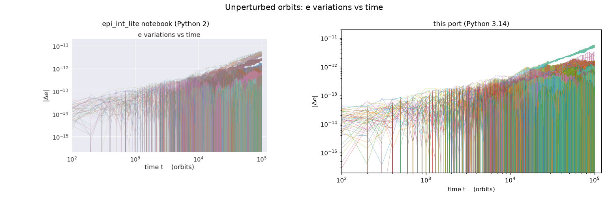
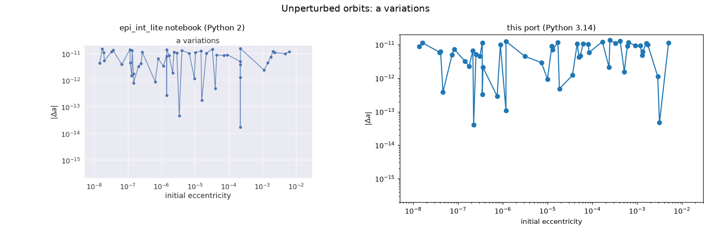
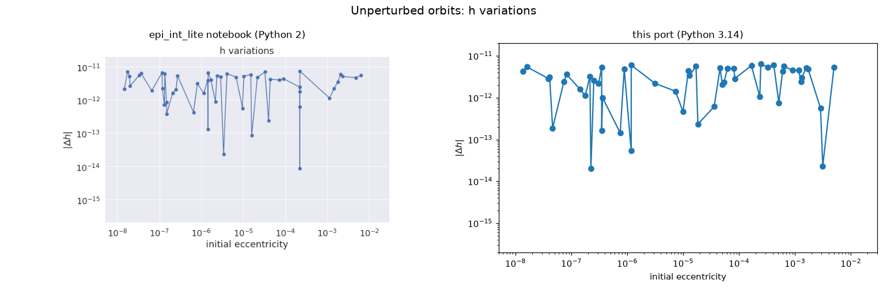

# Phase 0: the Python 3 port versus epi_int_lite's Python 2 results

Each test was rerun at full length with the port (`source/epi_int_lite.py`, Python 3.14,
NumPy 2.5) and analysed with the calculations of its epi_int_lite notebook
(`tests/analysis.py`). Figures: `uv run python tools/compare_port.py` redraws them from the
runs in `tests/*/output/` and places each beside the notebook's original. The reference
numbers are in each test's `reference/outputs.md`.

## Libration of a narrow eccentric ringlet

`tests/libration/narrow_ring/ring_mass_1.0e-9`: 2 streamlines of 241 particles, ring mass
10⁻⁹, 1.6×10⁴ orbits. The Borderies, Goldreich & Tremaine (BGT) libration frequency is the
analytic expectation.

| quantity | notebook (Python 2) | port (Python 3) |
|---|---|---|
| libration frequency ω | 6.389793429×10⁻⁴ | 6.389793431×10⁻⁴ |
| BGT frequency ω_BGT | 6.354576493×10⁻⁴ | 6.354576493×10⁻⁴ |
| ω/ω_BGT | 1.005541980 | 1.005541980 |
| H mean | 0.5003165495 | 0.5003165495 |
| integral of motion I | 2.850086668×10⁻³ | 2.850086657×10⁻³ |
| q std/mean | 0.06982389167 | 0.06982389162 |
| e′ at fixed point | 0.02890017658 | 0.02890017658 |
| Δe_eq | 1.448083774×10⁻⁵ | 1.448083774×10⁻⁵ |
| Δϖ_eq | 1.357692713×10⁻⁵ | 1.357694647×10⁻⁵ |
| ϖ′ at fixed point | 1.349879446×10⁻⁵ | 1.349879901×10⁻⁵ |
| e min, max | 0.002491742746, 0.002508260601 | 0.002491742746, 0.002508260601 |

Δϖ_eq and ϖ′ agree least, to 1 part in 10⁶: they are differences of two longitudes of order
1 radian, which amplifies roundoff by ~10⁵.

## Viscous spreading of a narrow ringlet

`tests/spreading`: 15 streamlines, viscosity 10⁻¹³, 50 viscous times τ_ν. The analytic
expectation is the spreading of an initially narrow ring (the notebook's profile).

| quantity | notebook (Python 2) | port (Python 3) |
|---|---|---|
| max ΔL/L (angular momentum) | 1.1319086×10⁻⁷ | 1.1319091×10⁻⁷ |
| max e | 5.4354380×10⁻⁸ | 5.4354388×10⁻⁸ |
| run time | 17.1 min | 3.5 min |

The simulated surface density matches the analytic profile to within 11–14% on interior
streamlines at all six times, as in the notebook's figure: 15 streamlines resolve the profile
coarsely, and the analytic solution assumes an initially infinitely narrow ringlet.

## Unperturbed orbits

`tests/unperturbed`: 51 streamlines of 3 particles with random 10⁻⁸ < e < 10⁻², no ring forces,
10⁵ orbits. The analytic expectation is that a, e and h = r v_θ stay constant.

| quantity | notebook (Python 2) | port (Python 3) |
|---|---|---|
| max \|Δa\| | ≈1.5×10⁻¹¹ (figure) | 1.4×10⁻¹¹ |
| max \|Δe\| | ≈5×10⁻¹² (figure) | 5.8×10⁻¹² |
| max \|Δh\| | ≈7×10⁻¹² (figure) | 6.5×10⁻¹² |

The eccentricities are random, and the notebook's run was unseeded, so individual particles
differ; the port's run uses `random_seed = 1`. The changes are roundoff, growing slowly with
time, at the same level in both.

