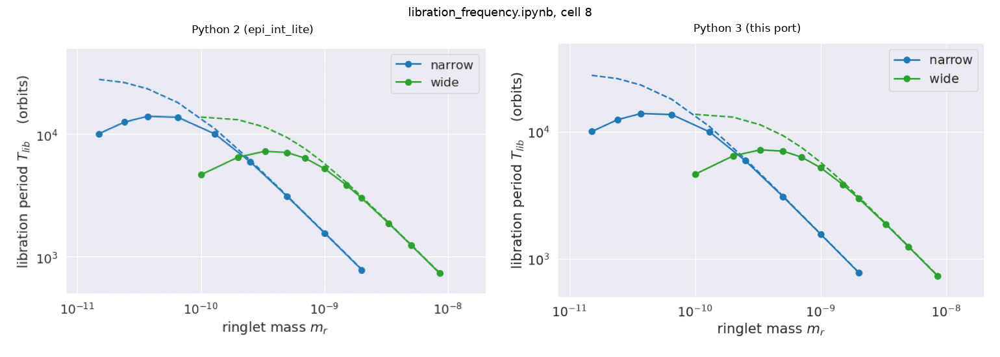
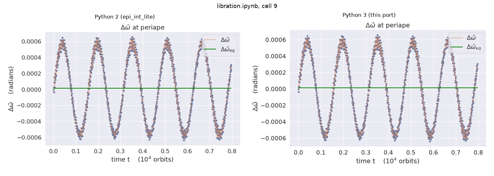
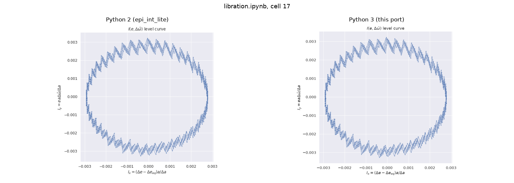
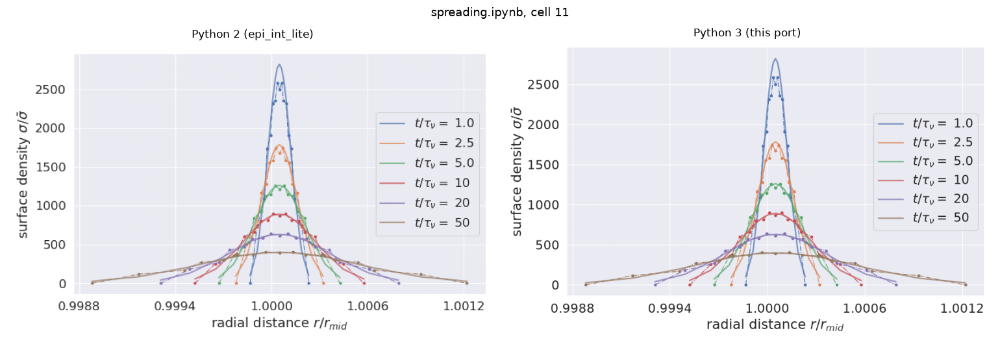
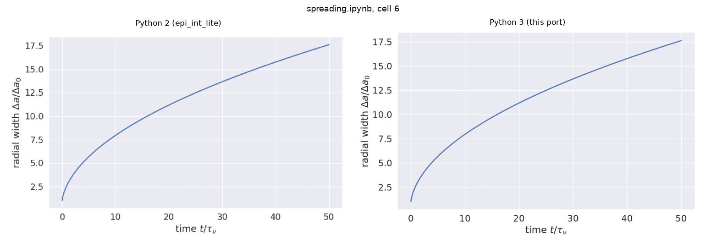
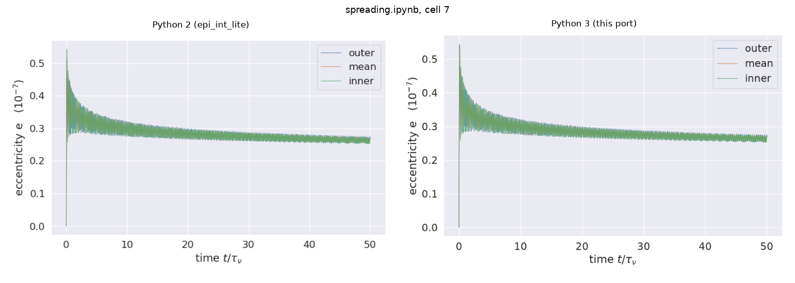
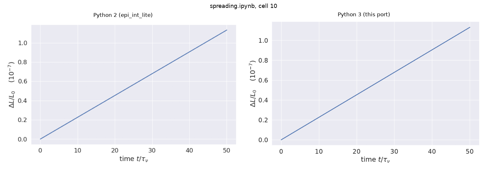
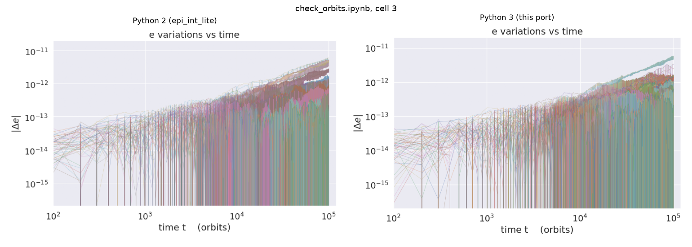
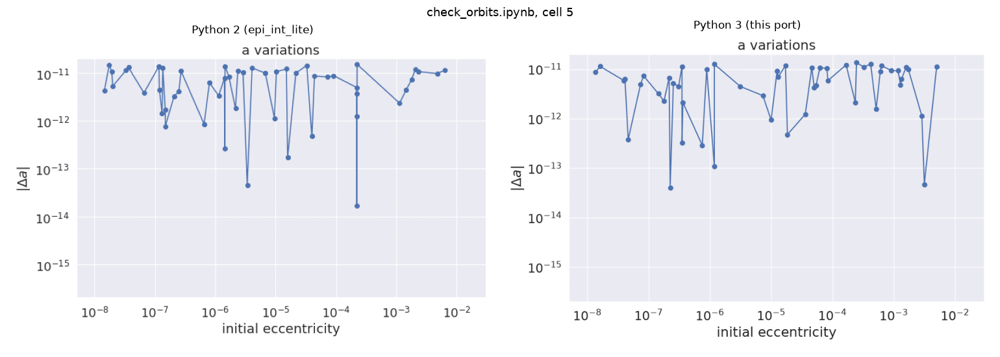
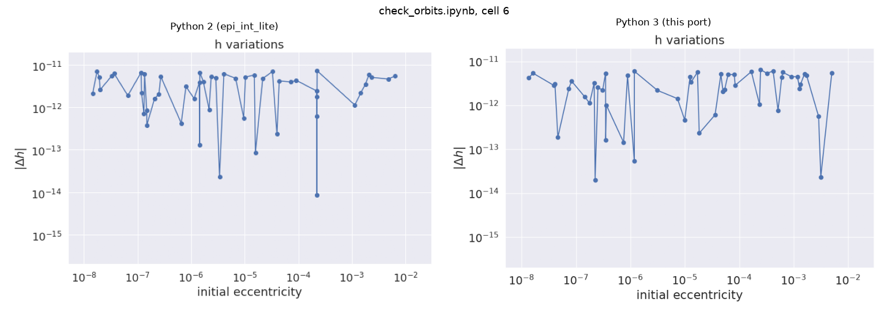

# Phase 0: the Python 3 port versus epi_int_lite's Python 2 results

epi_int_lite's own test notebooks were ported to Python 3 (only the changes Python 3 needs; see
`notes/port_changes.md`) and re-executed on full-length runs of the ported code, so the same
analysis code produced both sets of results:

| notebook | runs |
|---|---|
| `tests/unperturbed/check_orbits.ipynb` | 51 streamlines, random 10⁻⁸ < e < 10⁻², no ring forces, 10⁵ orbits |
| `tests/spreading/spreading.ipynb` | 15-streamline viscous ringlet, 50 viscous times |
| `tests/libration/narrow_ring/ring_mass_1.0e-9/libration.ipynb` | 2 streamlines × 241 particles, ring mass 10⁻⁹ |
| `tests/libration/libration_frequency.ipynb` | all 20 libration runs (9 narrow, 11 wide ringlets) |

The Python 2 notebooks, with their original outputs, are git commit `99a7753`.
`uv run python tools/compare_notebooks.py` prints every cell's output from both versions and
writes each figure beside its Python 2 original to `figs/<notebook>_cellNN.png`.

## Result

**The port reproduces the Python 2 results to 6–10 significant figures, and every figure is
visually indistinguishable from the original.** The results are not bit-identical: floating-point
roundoff differs between the 2018 Python 2 environment and this one (compiler, math library,
CPU), and it accumulates over 10⁵–10⁶ timesteps.

## Printed results

Narrow ringlet of mass 10⁻⁹ (`libration.ipynb`):

| quantity | Python 2 | Python 3 |
|---|---|---|
| libration frequency ω | 6.389793428950×10⁻⁴ | 6.389793430683×10⁻⁴ |
| BGT libration frequency ω_BGT | 6.354576492855×10⁻⁴ | 6.354576492793×10⁻⁴ |
| ω/ω_BGT | 1.0055419800 | 1.0055419803 |
| H mean | 0.50031654951691 | 0.50031654951686 |
| integral of motion I | 2.8500866683×10⁻³ | 2.8500866569×10⁻³ |
| q std/mean | 0.069823891666 | 0.069823891617 |
| e′ | 0.028900176582 | 0.028900176581 |
| Δe_eq | 1.4480837735029×10⁻⁵ | 1.4480837735167×10⁻⁵ |
| Δϖ_eq | 1.3576927×10⁻⁵ | 1.3576946×10⁻⁵ |
| ϖ′ | 1.3498794×10⁻⁵ | 1.3498799×10⁻⁵ |

Δϖ_eq and ϖ′ agree least, to 1 part in 10⁶: they are differences of two longitudes of order
1 radian, which amplifies roundoff by ~10⁵.

All 20 libration runs (`libration_frequency.ipynb`, cells 6 and 7): ΔI/I, ΔH/H, Δq/q, I, q, H
and e′ for every ringlet agree to all six printed digits, except ΔI/I of three ringlets, which
differs in the sixth digit (e.g. 0.251453 vs 0.251454); it depends on the extremes of I and is
the most roundoff-sensitive.

Viscous spreading (`spreading.ipynb`):

| quantity | Python 2 | Python 3 |
|---|---|---|
| max ΔL/L (angular momentum) | 1.1319086×10⁻⁷ | 1.1319091×10⁻⁷ |
| mean ring angular momentum | 1.0018981614430×10⁻¹⁰ | 1.0018981614430×10⁻¹⁰ |
| max e | 5.4354380×10⁻⁸ | 5.4354388×10⁻⁸ |
| run time | 17.1 min | 3.5 min |

Unperturbed orbits (`check_orbits.ipynb`): the eccentricities are random and the Python 2 run was
unseeded, so particles differ (the port's run uses `random_seed = 1`); its figures show the
changes in a, e and h growing to the same ~10⁻¹¹ by 10⁵ orbits.

## Figures

Libration: the libration period of all 20 ringlets versus ring mass, against the BGT prediction
(dashed), and the narrow ringlet of mass 10⁻⁹.

Viscous spreading: surface density versus the analytic solution, ringlet width, eccentricity and
angular momentum.

Unperturbed orbits: changes in e, a and h.

The other figures, one per notebook figure, are in `figs/`.
