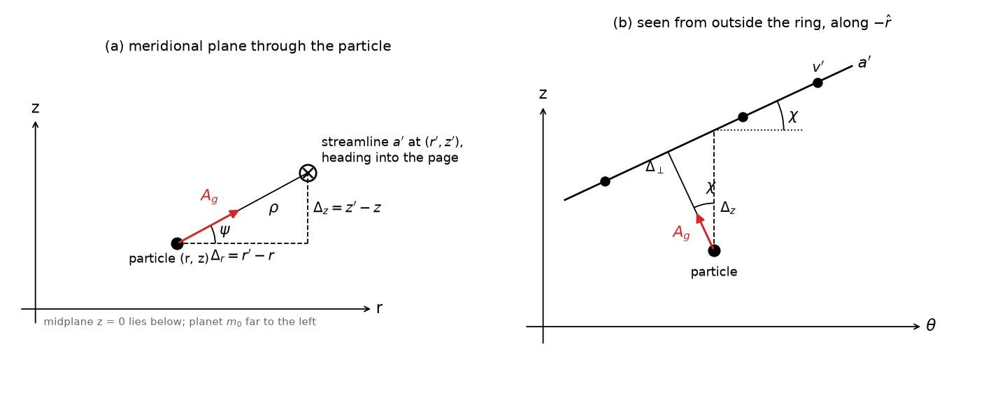

# Phase 2b: the vertical gravity of a streamline

How a perturbing streamline that lies off the particle's plane pulls on it, in the straight-wire
approximation that epi_int and epi_int_lite use in 2D (Hahn & Spitale 2013, hereafter hahn13, Sec.
2.3.2, Fig. 3, Eqs. 19–20; Hahn et al. 2025, Eq. 1). Equations G1–G6 are checked by
`notes/sympy/streamline_gravity.py` and tracked in `notes/equations.md`. The figure is made by
`wire_geometry.py`.

## The planar case (hahn13 Fig. 3)

Near the particle, the perturbing streamline a′ is a straight wire of linear density λ, which pulls
with A_g = 2Gλ/Δ toward the wire, where Δ is the perpendicular distance. The code finds the wire from
the three particles of streamline a′ nearest in longitude, using a Lagrange polynomial. It measures
the separation Δ_r = r′ − r at the particle's longitude, and takes the wire's direction from the
interpolated velocity of a′, with sin φ = v_r′/v′. Then A_r = A_g cos φ ≃ A_g and A_θ = −A_g sin φ ≃
−A_g v_r′/v_θ′, to lowest order in e′.

## The 3D geometry

Use the local frame (r̂, θ̂, ẑ) at the particle. The perturbing streamline crosses the particle's
meridional plane, at the particle's longitude, at (r′, z′). The separation from the particle to that
point is

  d = (Δ_r, 0, Δ_z),  Δ_r = r′ − r,  Δ_z = z′ − z,

where r′, z′ are interpolated to the particle's longitude as r′ is now. The wire runs along the unit
tangent

  T̂ = (ε, 1, η)/√(1 + ε² + η²),  ε = v_r′/v_θ′,  η = v_z′/v_θ′,

with the slopes ε ~ e′ and η ~ i′ taken, as in hahn13, from the streamline's interpolated velocity
(but see G6). Panel (a) shows the meridional plane: the wire pierces it at (r′, z′), a distance
ρ = √(Δ_r² + Δ_z²) away, at angle ψ above the horizontal, tan ψ = Δ_z/Δ_r. Panel (b) shows the view from
outside the ring. The wire is tilted by χ, with tan χ = η, so the perpendicular Δ_⊥ to the wire leans
back by χ, and A_g gains a small component along −θ̂. That is the vertical counterpart of the angle φ
in hahn13 Fig. 3, which tilts A_g toward −θ̂ by an amount set by the radial slope ε.

**G1 (exact wire).** The perpendicular from the particle to the wire is D = d − (d·T̂)T̂. Summing the
point-mass pull Gλ ds/|x|² along the whole wire gives

  **A_g = 2Gλ D/|D|²**,  |D|² = |d|² − (d·T̂)².

The sympy check confirms that D ⊥ T̂, and that the integral along the wire has a perpendicular part
2/|D|² and no parallel part.

**G2 (lowest order in the slopes).** To first order in ε and η, but exactly in Δ_z/Δ_r:

  **A_r = 2Gλ Δ_r/ρ²,  A_z = 2Gλ Δ_z/ρ²,  A_θ = −2Gλ (ε Δ_r + η Δ_z)/ρ²,  ρ² = Δ_r² + Δ_z²**

or, with the angles of the figure, A_r = A_g cos ψ, A_z = A_g sin ψ, A_g = 2Gλ/ρ. The second-order
terms are ±2Gλ(εΔ_r + ηΔ_z)(ηΔ_r − εΔ_z)Δ_{z,r}/ρ⁴ in A_r and A_z, and A_θ has none. So:

- A_z and A_r come from the meridional picture, panel (a), alone. The wire's tilts change them only at
  second order.
- The vertical force needs no small Δ_z/Δ_r. It stays valid when neighboring streamlines are
  displaced vertically by as much as their spacing, which is the regime λ_b ≲ amplitude that PLAN
  flags (hahn25 Sec. 7, item 3), where in-plane and vertical forcing couple. In that regime the
  radial pull weakens by Δ_r²/ρ². This is the "modified radial" force.
- The tilt η adds −2Gλ ηΔ_z/ρ² to A_θ (panel b). It is second order in the vertical amplitude, so it
  is negligible in linear bending waves.
- The second-order A_z term includes −2Gλ εη/Δ_r when Δ_z ≪ Δ_r, an O(e·i) coupling. Compared with
  the first-order A_z, it is of relative size εηΔ_r/Δ_z.

**G3 (the planar limit).** With Δ_z = η = 0, the exact wire gives A = (2Gλ/Δ_r)(1, −ε, 0), exactly.
That is hahn13 Eq. 20 to first order. The code's (2Gλ/Δ_r)(cos φ, −sin φ) is the exact wire times
1/√(1 + ε²), which differs only at O(e²). So G2 reduces to what epi_int_lite does now.

## Checks against the continuum: the bending-wave restoring force

**G4.** Consider a sheet of surface density σ, made of streamlines with λ = σ dr′, at height
Z(r) = Z₀ cos kr. When |Δ_z| ≪ |Δ_r|, the sum of G2's A_z over the sheet is

  A_z = 2Gσ Z₀ ∫ (cos kx − 1)/x² dx = −2πGσ|k| Z.

That is the self-gravity term of the bending-wave dispersion relation, (ω − mΩ)² = ν² + 2πGσ|k|
(e.g. Shu 1984). So summing wire forces over the streamlines gives the vertical restoring force of a
self-gravitating sheet, as the same sum gives −2πGσ|k| for in-plane density waves. In the bending case
gravity is restoring, so it adds to ν².

**G5 (on the code's lattice).** Take streamlines spaced Δ, with Z_j = Z₀ cos(jφ). Then

  A_z = (4GσZ₀/Δ) Σ_{n≥1} (cos nφ − 1)/n² = −X(φ) Z₀,  X = (4Gσ/Δ)(πφ/2 − φ²/4),

which is exactly the X of P7, the coded gravity on an in-plane lattice mode. So the vertical lattice
frequency is ω² = ν² + X. It tends to the continuum 2πGσk as φ = kΔ → 0, and at the zigzag φ = π it
reaches half the continuum value, as in-plane. Vertically, though, the extra gravity is stabilizing
(P8's 𝓡 limit is an in-plane one).

## The wire's direction: velocity versus shape

**G6.** hahn13 takes the wire's direction from the streamline's velocity. The gravity, however, comes
from the streamline's instantaneous shape. Suppose that shape, r′(θ − Ω_p t) and z′(θ − Ω_p t), rotates
at pattern speed Ω_p. Then

  v_r′/v_θ′ = (1 − Ω_p/Ω)(1/r) ∂r′/∂θ,  and likewise for z.

For the m = 1 patterns of epi_int_lite's ringlets, Ω_p is the slow precession rate, so velocity and
shape agree to O(J₂). For an m-armed pattern near resonance, the velocity's slope is about 1/m of the
shape's. Taking the tangent from the velocity is part of the wire model of hahn13 and hahn25, and
epi_int_3d keeps it (issue 7, closed). Vertically, η enters only A_θ, at second order, so the
bending forces A_z do not depend on this choice.

## What this means for the code (Phase 3 step 2, after your review)

- **What changes in the kernel.** `fast/kernels.py` gains Lagrange interpolation of z′, and v_z′ if
  the η term is kept, at the particle's longitude. It then applies G2 in a form that reduces bit for
  bit to the present arithmetic at Δ_z = 0, so that z ≡ 0 still reproduces the reference:
  - q = Δ_z/Δ_r;
  - A = 2Gλ/(Δ_r(1 + q²)), which is the present 2Gλ/Δ_r when q = 0;
  - A_r = A cos φ, A_θ = −A sin φ, A_z = A q.

  This keeps hahn13's cos φ and sin φ, so it differs from G2 only at O(ε²). It omits the
  second-order η term of A_θ, which can be added later if wanted. Δ_r ≠ 0 holds because streamlines
  never cross radially, which the crossing check enforces.
- **The particle's own streamline.** epi_int_lite leaves out the particle's own streamline (hahn13
  Eq. 21 is not in the code). In 3D its pull on the particle has no vertical part to lowest order: the
  particle sits on that wire, so Δ_z = 0. Out-of-plane curvature of the streamline would add a vertical
  term of relative size about m²Δ_r/(kr) times a logarithm, which is small when Δ_r ≪ λ_b ≪ r.
- **λ.** The reference uses the perturbed particle's own λ = m₁Ω/(2πv) for every perturbing
  streamline, not λ′ of the perturbing one (`helper_fns.ring_gravity`, issue 8). It is fixed in
  `fast/epi_int_3d.py`, opt-in via `fix_lambda = True`: λ′ is interpolated to the particle's longitude
  like r′. The 3D kernel will use λ′ when `fix_lambda` is on. The 3D speed v in λ would add only O(i²).
- **Validity.** The wire approximation needs ρ to be much smaller than the length over which the
  streamline curves, r/m in azimuth, just as in 2D.
