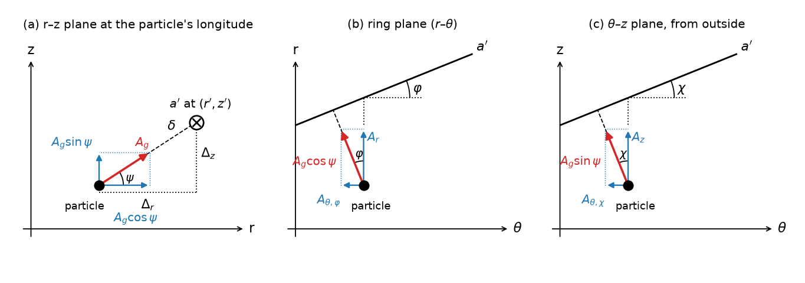

# Phase 2b: the vertical gravity of a streamline

How a perturbing streamline that lies off the particle's plane pulls on it, in the straight-wire
approximation that epi_int and epi_int_lite use in 2D (Hahn & Spitale 2013, hereafter hahn13, Sec.
2.3.2, Fig. 3, Eqs. 19–20; Hahn et al. 2025, Eq. 1). Equations G1–G14 are checked by
`notes/sympy/streamline_gravity.py` and tracked in `notes/equations.md`. The figure is made by
`paper/figures/wire_geometry.py`. This derivation is Section 3 and Figure 1 of the draft paper
(`paper/epi_int_3d.tex`).

## The planar case (hahn13 Fig. 3)

Near the particle, the perturbing streamline a′ is a straight wire of linear density λ, which pulls
with A_g = 2Gλ/Δ toward the wire, where Δ is the perpendicular distance. The code finds the wire from
the three particles of streamline a′ nearest in longitude, using a Lagrange polynomial. It measures
the separation Δ_r = r′ − r at the particle's longitude, and takes the wire's direction from the
interpolated velocity of a′, with sin φ = v_r′/v′. Then A_r = A_g cos φ ≃ A_g and A_θ = −A_g sin φ ≃
−A_g v_r′/v_θ′, to lowest order in e′.

## The paper's derivation (G12): hahn13 Fig. 3 moved and tilted

**G12.** (1) Raising particle and wire together by z changes nothing (|z| ≪ r). (2) Raising the wire by
d_z, still horizontal: from above it is hahn13 Fig. 3 (tan φ = s_r), with horizontal perpendicular
Δ_h = d_r cos φ along (cos φ, −sin φ); the full perpendicular adds the vertical leg d_z,
Δ = (Δ_h cos φ, −Δ_h sin φ, d_z), Δ² = d_r² cos²φ + d_z², exactly. (3) Tilting the wire by its vertical
slope s_z adds −d_z s_z to Δ_θ; the other changes are O(s_r s_z, s_z²), the order of the drift's
neglected e·i and i² terms. So

  **A_r = 2Gλ d_r cos²φ/Δ²,  A_θ = −2Gλ(d_r sin φ cos φ + d_z s_z)/Δ²,  A_z = 2Gλ d_z/Δ².**

In the plane, (2Gλ/d_r)(1, −s_r) exactly. G11 (below) is the exact wire this approximates.

## The exact straight wire (G11)

**G11.** Only two approximations: the perturbing streamline is, near the particle, a straight infinite
wire of linear density λ, and |r′ − r|, |z′ − z| ≪ r, so the local frame (r̂, θ̂, ẑ) is Cartesian there.
No small slopes and no spiral-wave theory. The Lagrange polynomials give the crossing point at
d = (d_r, 0, d_z) = (r′ − r, 0, z′ − z) and the wire's direction t = (s_r, 1, s_z), s_r = ∂r′/r∂θ,
s_z = ∂z′/r∂θ. The nearest point is d + u t with (d + u t)·t = 0, u = −c, c = (d_r s_r + d_z s_z)/(1 + s_r² + s_z²):

  **Δ = d − c t = (d_r − c s_r, −c, d_z − c s_z),  Δ² = d_r² + d_z² − c(d_r s_r + d_z s_z),**
  **A_r = 2Gλ(d_r − c s_r)/Δ²,  A_θ = −2Gλc/Δ²,  A_z = 2Gλ(d_z − c s_z)/Δ².**

Exact for the wire at any tilt; in the plane A = (2Gλ/d_r)(1, −s_r, 0), hahn13 Eq. 20 with the shape's
slope. epi_int_lite's (2Gλ/d_r)(cos φ, −sin φ) with the velocity φ is kept only as a regression option.
G9 and G10 below are first-order versions of the same thing.

## First-order versions (G9, G10)

**G10 (the wire along the shape; what the paper now uses).** No approximation may be problematic for
m ≥ 2 spiral waves, so the wire runs along the streamline's *shape*, not its velocity: the tangent
t̂′ ∝ (s_r, 1, s_z), with s_r = (1/r)∂r′/∂θ and s_z = (1/r)∂z′/∂θ from the derivatives of the same
Lagrange polynomials that give r′ and z′. Then Δ_θ = −Δ_r s_r − Δ_z s_z, and in the plane
Δ = Δ_r cos φ (cos φ, −sin φ, 0) exactly, tan φ = s_r. The velocity's slope is (1 − Ω_p/Ω_a) times the
shape's (G6), which is ±1/m at an m-armed Lindblad or vertical resonance (checked in G10), so the
velocity tangent would underestimate A_θ, and the angular momentum streamlines exchange, by about m.
For m = 1 ringlets (hahn13, hahn25) the two agree to O(J2). Errors are O(s²), with s_r ~ m e′ and
s_z ~ m i′. G9 below is the same derivation with the velocity tangent.

**G9.** The paper keeps hahn13's notation: Δ is the perpendicular from the particle to the wire (the
|D| of G1 below), and A_g = 2Gλ/Δ along it. In 3D the perpendicular is a vector Δ = (Δ_r, Δ_θ, Δ_z),
so A_g,r = A_g Δ_r/Δ, A_g,θ = A_g Δ_θ/Δ, A_g,z = A_g Δ_z/Δ. Exactly, Δ = d − (d·v̂′)v̂′ = v̂′ × (d × v̂′)
with d = (r′ − r, 0, z′ − z) the separation to where the wire crosses the particle's longitude (G8).
The paper derives the first-order form in three steps: the nearest point is only O(e′, i′)Δ along
the wire from the crossing point, so Δ_r = r′ − r and Δ_z = z′ − z; perpendicularity, Δ·v′ = 0, gives
Δ_θ = −(Δ_r v_r′ + Δ_z v_z′)/v_θ′; and Δ_θ² is second order, so Δ = √(Δ_r² + Δ_z²). In the plane Δ = Δ_r cos φ (cos φ, −sin φ, 0) exactly, which
is hahn13 Fig. 3 and Eq. 20; epi_int_lite uses Δ_r for hahn13's Δ = Δ_r cos φ. Panels (a) and (b) are
hahn13 Fig. 3 in the r–θ and z–θ planes; panel (c) is the r–z plane at the particle's longitude.
Below, δ is this first-order Δ, and G7 is the same result written with angles.

## The same result with angles (G7)

**G7.** Lagrange interpolation at the particle's longitude gives the spot (r′, θ, z′) on streamline a′,
Δ_r outward and Δ_z above the particle, δ = √(Δ_r² + Δ_z²) away, in the r–z plane at the particle's
longitude (its meridional plane, which contains the planet's spin axis; panel a). The wire crosses that
plane nearly at right angles, so it pulls with A_g = 2Gλ/δ toward the spot, at angle ψ, tan ψ = Δ_z/Δ_r:
an in-plane part A_g cos ψ and a vertical part A_g sin ψ. Then two steps:
1. the wire's tilt φ in the ring plane splits the in-plane part as in hahn13 (panel b):
   A_r = A_g cos ψ cos φ, A_θ,φ = −A_g cos ψ sin φ, with cos φ = v_θ′/v′, sin φ = v_r′/v′ and
   v′ = √(v_r′² + v_θ′²) the in-plane speed (hahn13 approximates cos φ ≃ 1, sin φ ≃ v_r′/v_θ′; the
   code uses the ratios);
2. the wire's tilt χ in the θ–z plane, sin χ = v_z′/√(v_θ′² + v_z′²), tips the vertical part toward −θ̂
   (panel c): A_θ,χ = −A_g sin ψ sin χ, and A_z = A_g sin ψ to first order.

  **A_r = A_g cos ψ cos φ,  A_θ = −A_g (cos ψ sin φ + sin ψ sin χ),  A_z = A_g sin ψ.**

This equals the exact wire (G1) to first order in the slopes, with errors O(e′², i′², e′i′), and at
Δ_z = 0 it is hahn13 Eq. 20 exactly as coded. G1–G3 below are the longer derivation that checks it.

## The exact wire (the check of G7)

**G8 (vector form).** With Δ = (Δ_r, 0, Δ_z) and the wire's direction v̂′ = v′/v′, in the shared local
frame: D = Δ − (Δ·v̂′)v̂′ = v̂′ × (Δ × v̂′) and A_g = 2Gλ D/|D|² = 2Gλ(Δ − (Δ·v̂′)v̂′)/(δ² − (Δ·v̂′)²).
This is G1 below; G7 is its first-order form, and in the ring plane G7 as coded is it times cos φ.

In the local frame (r̂, θ̂, ẑ) at the particle:

The perturbing streamline crosses the particle's
meridional plane, at the particle's longitude, at (r′, z′). The separation from the particle to that
point is

  d = (Δ_r, 0, Δ_z),  Δ_r = r′ − r,  Δ_z = z′ − z,

where r′, z′ are interpolated to the particle's longitude as r′ is now. The wire runs along the unit
tangent

  T̂ = (ε, 1, η)/√(1 + ε² + η²),  ε = v_r′/v_θ′,  η = v_z′/v_θ′,

with the slopes ε ~ e′ and η ~ i′ taken, as in hahn13, from the streamline's interpolated velocity
(but see G6). Panel (a) shows the meridional plane: the wire pierces it at (r′, z′), a distance
δ = √(Δ_r² + Δ_z²) away, at angle ψ above the horizontal, tan ψ = Δ_z/Δ_r. Panel (b) shows the view from
outside the ring. The wire is tilted by χ, with tan χ = η, so the perpendicular Δ_⊥ to the wire leans
back by χ, and A_g gains a small component along −θ̂. That is the vertical counterpart of the angle φ
in hahn13 Fig. 3, which tilts A_g toward −θ̂ by an amount set by the radial slope ε.

**G1 (exact wire).** The perpendicular from the particle to the wire is D = d − (d·T̂)T̂. Summing the
point-mass pull Gλ ds/|x|² along the whole wire gives

  **A_g = 2Gλ D/|D|²**,  |D|² = |d|² − (d·T̂)².

The sympy check confirms that D ⊥ T̂, and that the integral along the wire has a perpendicular part
2/|D|² and no parallel part.

**G2 (lowest order in the slopes).** To first order in ε and η, but exactly in Δ_z/Δ_r:

  **A_r = 2Gλ Δ_r/δ²,  A_z = 2Gλ Δ_z/δ²,  A_θ = −2Gλ (ε Δ_r + η Δ_z)/δ²,  δ² = Δ_r² + Δ_z²**

or, with the angles of the figure, A_r = A_g cos ψ, A_z = A_g sin ψ, A_g = 2Gλ/δ. The second-order
terms are ±2Gλ(εΔ_r + ηΔ_z)(ηΔ_r − εΔ_z)Δ_{z,r}/δ⁴ in A_r and A_z, and A_θ has none. So:

- A_z and A_r come from the meridional picture, panel (a), alone. The wire's tilts change them only at
  second order.
- The vertical force needs no small Δ_z/Δ_r. It stays valid when neighboring streamlines are
  displaced vertically by as much as their spacing, which is the regime λ_b ≲ amplitude that PLAN
  flags (hahn25 Sec. 7, item 3), where in-plane and vertical forcing couple. In that regime the
  radial pull weakens by Δ_r²/δ². This is the "modified radial" force.
- The tilt η adds −2Gλ ηΔ_z/δ² to A_θ (panel b). It is second order in the vertical amplitude, so it
  is negligible in linear bending waves.
- The second-order A_z term includes −2Gλ εη/Δ_r when Δ_z ≪ Δ_r, an O(e·i) coupling. Compared with
  the first-order A_z, it is of relative size εηΔ_r/Δ_z.

**G3 (the planar limit).** With Δ_z = η = 0, the exact wire gives A = (2Gλ/Δ_r)(1, −ε, 0), exactly.
That is hahn13 Eq. 20 to first order. The code's (2Gλ/Δ_r)(cos φ, −sin φ) is the exact wire times
1/√(1 + ε²), which differs only at O(e²). So G2 reduces to what epi_int_lite does now.

## Checks against the continuum: the bending-wave restoring force

**G4.** Consider a sheet of surface density σ, made of streamlines with λ = σ dr′, at height
Z(r) = Z₀ cos kr. When |Δ_z| ≪ |Δ_r|, the sum of G2's A_z over the sheet is

  A_z = 2Gσ Z₀ ∫ (cos kx − 1)/x² dx = −2πGσ|k| Z.

That is the self-gravity term of the bending-wave dispersion relation, (ω − mΩ)² = ν² + 2πGσ|k|
(e.g. Shu 1984). So summing wire forces over the streamlines gives the vertical restoring force of a
self-gravitating sheet, as the same sum gives −2πGσ|k| for in-plane density waves. In the bending case
gravity is restoring, so it adds to ν².

**G5 (on the code's lattice).** Take streamlines spaced Δ, with Z_j = Z₀ cos(jφ). Then

  A_z = (4GσZ₀/Δ) Σ_{n≥1} (cos nφ − 1)/n² = −X(φ) Z₀,  X = (4Gσ/Δ)(πφ/2 − φ²/4),

which is exactly the X of P7, the coded gravity on an in-plane lattice mode. So the vertical lattice
frequency is ω² = ν² + X. It tends to the continuum 2πGσk as φ = kΔ → 0, and at the zigzag φ = π it
reaches half the continuum value, as in-plane. Vertically, though, the extra gravity is stabilizing
(P8's 𝓡 limit is an in-plane one).

## The wire's direction: velocity versus shape

**G6.** hahn13 takes the wire's direction from the streamline's velocity. The gravity, however, comes
from the streamline's instantaneous shape. Suppose that shape, r′(θ − Ω_p t) and z′(θ − Ω_p t), rotates
at pattern speed Ω_p. Then

  v_r′/v_θ′ = (1 − Ω_p/Ω)(1/r) ∂r′/∂θ,  and likewise for z.

For the m = 1 patterns of epi_int_lite's ringlets, Ω_p is the slow precession rate, so velocity and
shape agree to O(J₂). For an m-armed pattern near resonance, the velocity's slope is about 1/m of the
shape's. Taking the tangent from the velocity is part of the wire model of hahn13 and hahn25, and
epi_int_3d keeps it. Vertically, η enters only A_θ, at second order, so the
bending forces A_z do not depend on this choice.

## What this means for the code (Phase 3 step 2, after your review)

- **Decided 2026-10-23 (G13, paper Sec. 3.3):** keep epi_int_lite's crossing-point evaluation,
  Δ² = d_r² + d_z², A_r = 2Gλ′d_r cos φ/Δ², A_θ = −2Gλ′(d_r sin φ + d_z s_z)/Δ², A_z = 2Gλ′d_z/Δ²;
  λ′ (fix_lambda) on by default for epi_int_3d runs; cos φ, sin φ from the velocity by default (so
  z ≡ 0 is bit for bit epi_int_lite), from the shape as an option for in-plane m ≥ 2 runs; s_z always
  from the shape (the Lagrange derivative). The bullets below are the earlier plan.

- **Wire tangent (G10).** The kernel takes s_r and s_z from the derivative of the 3-point Lagrange
  polynomial, cos φ = 1/√(1 + s_r²), sin φ = s_r cos φ, A_θ = −A(sin φ + q s_z). An input (e.g.
  `wire_tangent = 'velocity'`) keeps epi_int_lite's v_r′/v′, v_θ′/v′ in the plane, so z ≡ 0 runs still
  reproduce the reference bit for bit; m ≥ 2 runs use the shape. Needs N_θ ≫ m.
- **λ for m ≥ 2 (open).** `helper_fns.get_lambda` uses λ = m₁Ω_a/(2πv), a mass-flux argument that holds
  for a stationary streamline. For a pattern rotating at Ω_p the conserved flux is in the pattern's
  frame, λ ∝ 1/(v − Ω_p r), so λ's variation along an m ≥ 2 streamline is underestimated by about m.
  A geometric λ (particle mass over the arc length between neighbors) has no such assumption. To be
  derived, sympy-checked and decided.

- **What changes in the kernel.** `fast/kernels.py` gains Lagrange interpolation of z′, and v_z′ if
  the η term is kept, at the particle's longitude. It then applies G2 in a form that reduces bit for
  bit to the present arithmetic at Δ_z = 0, so that z ≡ 0 still reproduces the reference:
  - q = Δ_z/Δ_r;
  - A = 2Gλ/(Δ_r(1 + q²)), which is the present 2Gλ/Δ_r when q = 0;
  - A_r = A cos φ, A_θ = −A(sin φ + q sin χ), A_z = A q, with z′ and v_z′ interpolated like r′, v_r′.

  This is G7 exactly (A = A_g cos ψ), so it keeps hahn13's cos φ and sin φ and the χ tilt term. Δ_r ≠ 0 holds because streamlines
  never cross radially, which the crossing check enforces.
- **The particle's own streamline.** epi_int_lite leaves out the particle's own streamline (hahn13
  Eq. 21 is not in the code). In 3D its pull on the particle has no vertical part to lowest order: the
  particle sits on that wire, so Δ_z = 0. Out-of-plane curvature of the streamline would add a vertical
  term of relative size about m²Δ_r/(kr) times a logarithm, which is small when Δ_r ≪ λ_b ≪ r.
- **λ.** The reference uses the perturbed particle's own λ = m₁Ω/(2πv) for every perturbing
  streamline, not λ′ of the perturbing one (`helper_fns.ring_gravity`, issue 7). It is fixed in
  `fast/epi_int_3d.py`, opt-in via `fix_lambda = True`: λ′ is interpolated to the particle's longitude
  like r′. The 3D kernel will use λ′ when `fix_lambda` is on. The 3D speed v in λ would add only O(i²).
- **Validity.** The wire approximation needs δ to be much smaller than the length over which the
  streamline curves, r/m in azimuth, just as in 2D.
